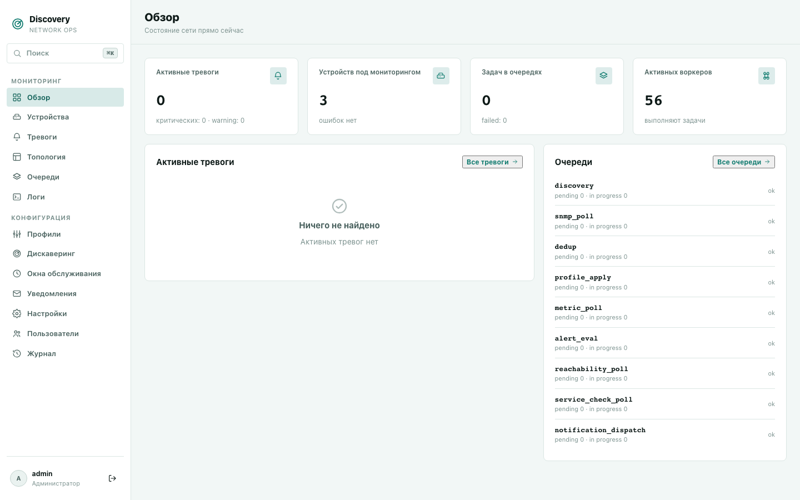

# discovery

Открытая система мониторинга сетевых устройств для интернет-провайдеров: обнаруживает
коммутаторы, OLT и другое сетевое оборудование, опрашивает метрики по SNMP, поднимает
тревоги при отклонениях и авариях и отправляет уведомления в Telegram, email или webhook.
Работает полностью на вашей инфраструктуре, без облака.

Один бинарник на Rust со встроенным веб-дашбордом на React. По умолчанию хранит данные в
SQLite, внешние базы данных не нужны.



## Возможности

- **Обнаружение устройств.** Сканирует подсети по SNMP (v1/v2c/v3) и сама создаёт
  устройство при первом ответе. Есть сервис-дискаверинг: разовая проверка SNMP, SSH,
  HTTP(S) и TCP с автоматическим выбором профиля.
- **Опрос метрик по профилям.** Любые OID с любой периодичностью под любую модель
  оборудования. Есть табличные метрики, производные метрики (rate/delta), сервис-чеки
  L4–L7 и SSH CLI-pull.
- **Тревоги.** Пороговые и системные срабатывания на любую метрику. Поддерживаются
  гистерезис, защита от flapping, подтверждение, временное подавление (snooze),
  эскалация, окна обслуживания и групповая корреляция по топологии.
- **Приём событий.** SNMP trap и syslog.
- **Топология.** Связи соседей по LLDP/CDP.
- **Уведомления.** Email, Telegram и webhook с настройкой, кого и когда извещать.
- **ИИ-ассистент.** Чат прямо в дашборде, работает через GigaChat, OpenRouter или
  self-hosted сервер (vLLM/Ollama). У ассистента ровно те права, что и у пользователя, а
  изменяющие действия требуют подтверждения.
- **Доступ и аудит.** Локальные пользователи, роли с правами чтения и записи по доменам и
  журнал всех изменяющих действий.
- **REST API.** Всё, что умеет дашборд, доступно через REST.
- **Хранилища.** SQLite, PostgreSQL, MySQL, ClickHouse и Cassandra. Отдельные домены
  данных можно разнести по разным базам.

## Быстрый старт

### Docker

```bash
git clone https://github.com/seelentov/discovery.git
cd discovery
cp .env.example .env
# в .env задайте:
#   DISCOVERY_SECRET_KEY=<вывод openssl rand -base64 32>
#   DISCOVERY_BOOTSTRAP_ADMIN_PASSWORD=<пароль первого входа, не короче 8 символов>
docker compose up -d --build
```

Откройте `http://localhost:8088` и войдите как `admin` с паролем из `.env`. При первом
входе система попросит сменить пароль.

### Пакет .deb / .rpm

Готовые пакеты и архивы для macOS и Windows публикуются на странице
[Releases](https://github.com/seelentov/discovery/releases). Подробнее в разделе
[Установка](docs/installation.md).

### Сборка из исходников

Нужны Rust (stable) и Node.js 20+.

```bash
(cd crates/web/frontend && npm ci && npm run build)   # UI встраивается в бинарник
cargo build --release -p discovery-agent
```

Запуск и минимальный `config.toml` описаны в [QUICKSTART.md](QUICKSTART.md).

## Документация

| Раздел | Что внутри |
|---|---|
| [Установка](docs/installation.md) | Пакеты, Docker, архивы, сборка из исходников, первый вход, обновление |
| [Возможности](docs/features.md) | Обзор функций продукта |
| [Руководство по разделам](docs/features/) | По одной странице на каждый раздел дашборда с описанием полей |
| [Конфигурация](docs/configuration.md) | Справочник `config.toml` и переменных окружения |
| [REST API](docs/api-reference.md) | Маршруты, права доступа, коды ошибок |
| [Диагностика](docs/troubleshooting.md) | Типичные проблемы и их решения |

## Разработка

```bash
cd crates/web/frontend && npm ci && npm run build && npm run lint && cd -
cargo test --workspace
```

Карта кодовой базы находится в [AI_CONTEXT.md](AI_CONTEXT.md), соглашения по разработке
и проверкам описаны в [AGENTS.md](AGENTS.md). E2E-тесты на Playwright лежат в
`crates/web/frontend/e2e/`.

Ошибки и предложения оформляйте в
[Issues](https://github.com/seelentov/discovery/issues), изменения присылайте
pull request'ами.

## Лицензия

[Apache License 2.0](LICENSE).
