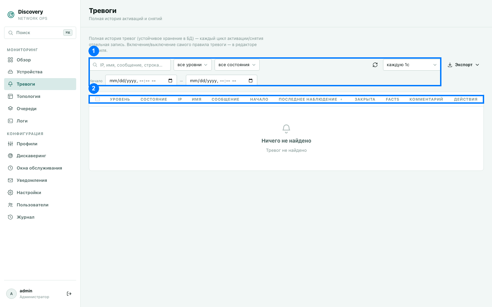

# Тревоги

Полная история срабатываний — и активных сейчас, и уже закрытых за всё время. В отличие
от карточки на странице «Обзор» (только 10 последних активных), здесь — весь список с
фильтрами, сортировкой и историей.



1. Панель фильтров · 2. Заголовки столбцов

На скриншоте выше активных тревог нет — показан пустой список. Ниже описано, как выглядит
и ведёт себя список с реальными тревогами, по коду.

## Что такое тревога и как она возникает

Тревога — это срабатывание правила, заданного в профиле устройства (см.
[Профили](profiles.md) → вкладка «Тревоги»). У правила есть условие активации (например,
«загрузка CPU выше 90%») и, отдельно, условие деактивации (например, «загрузка CPU ниже
70%»). Именно раздельные условия делают возможным **гистерезис** — тревога не начинает
дребезжать (activate → clear → activate...) на границе одного порога: она остаётся
активной всё время, пока метрика находится в «мёртвой зоне» между порогом срабатывания и
порогом снятия.

Если правило не задаёт отдельного условия деактивации — система по умолчанию считает
деактивацией просто отрицание условия активации.

**Уровни серьёзности:**
- `Critical` (красный) — серьёзная проблема: устройство недоступно, критичный порог
  нарушен.
- `Warning` (жёлтый) — предупреждение, не критично, но заслуживает внимания.
- `Info` (нейтральный) — информационное сообщение.

## Столбцы таблицы (2)

| Столбец | Что означает |
|---|---|
| Чекбокс | Для массового закрытия сразу нескольких тревог (см. ниже). Доступен только для активных тревог. |
| Уровень | Цветной бейдж — Critical/Warning/Info. |
| Устройство | IP устройства, вызвавшего тревогу — клик открывает карточку устройства в разделе «Устройства». |
| Тревога | Имя правила, идентичность строки (`row_key`) если тревога привязана к конкретному порту/строке метрики, и текст сообщения (из настроек правила в профиле). |
| Facts | Клик открывает полный снимок данных, которые были актуальны **в момент активации** этой конкретной тревоги (если правило настроено их сохранять) — автоматически форматируется как таблица, если это похоже на JSON/CSV/XML. |
| Обнаружена | Когда тревога впервые сработала. |
| Обновлена | Когда в последний раз подтверждалось, что условие всё ещё выполняется (для активной тревоги) — обновляется на каждом цикле проверки, даже если ничего не изменилось. |
| Статус | «Активна» / «Закрыта» (закрыта вручную — рядом имя закрывшего пользователя) / «Утеряна» (см. ниже). Дополнительные признаки: подтверждена, snooze до срока, flapping (уведомление подавлено), escalation level и group suppression. Для group suppression клик по бейджу открывает карточку причинной тревоги. |
| Комментарии | Число сообщений в обсуждении тревоги, если есть — клик открывает тред. |
| Действия | Закрыть (только для активных), Комментарии, Удалить. |

## Статус «Утеряна» — не то же самое, что «Закрыта»

Если тревога была привязана к конкретной строке метрики (например, к конкретному порту в
таблице интерфейсов) и эта строка полностью пропала из данных устройства (например, порт
исчез из таблицы после перезагрузки коммутатора) — тревога автоматически помечается как
«Утеряна», а не «Закрыта». Смысл разный: «Закрыта» означает, что условие деактивации
реально стало истинным (проблема решена); «Утеряна» означает, что система больше не может
проверить это условие вообще, потому что сама строка данных исчезла.

## Панель фильтров (1)

- **Поиск** — по IP устройства, имени тревоги, сообщению.
- **Уровень** — фильтр по Critical/Warning/Info.
- **Статус** — фильтр по активна/закрыта.
- **С — По** — период по дате обнаружения. По умолчанию оба поля пустые (показывается вся
  история без ограничения по времени) — это намеренно: список тревог не журнал за
  последние сутки, а полноценная база инцидентов, сужать которую по умолчанию не должно.
- **Период автообновления** — от отключено до раза в секунду (по умолчанию — без
  автообновления, список обновляется вручную или кнопкой ⟳).

## Действия

**Закрыть** — вручную закрывает активную тревогу; система запрашивает подтверждение,
поскольку это действие не проверяет реальное состояние устройства. Используется, когда вы
точно знаете, что проблема решена, но автоматическое условие деактивации почему-то не
сработало (например, устройство сняли с мониторинга раньше, чем оно успело бы само
подтвердить восстановление). При ручном закрытии в истории сохраняется, кто именно закрыл
тревогу. **Если условие на устройстве на самом деле всё ещё истинно** — тревога может
активироваться заново уже на следующей проверке; если это произошло в течение 10 минут
после ручного закрытия, новая запись помечается бейджем «повторная» со ссылкой на
предыдущую (закрытую) запись — чтобы история расследования не терялась.

**Подтвердить** — операторская отметка с именем и временем. Для правил состояния она не меняет состояние
тревоги и не останавливает её проверку. В режимах `change` и `event` без условия восстановления подтверждение закрывает отдельное событие. **Снять подтверждение** удаляет только эту
отметку.

**Snooze** — временно подавляет уведомления activation/recovery до указанного времени;
сама тревога остаётся активной. После истечения срока доставка снова разрешена. Snooze не
равен закрытию, окну обслуживания или групповой причинной suppression.

Если для правила задана политика повторов, активная неподтверждённая тревога получает
повторные уведомления после задержки и через заданный интервал. При достижении порога она
переходит на следующий уровень escalation с собственными получателями; повторы ограничены
максимумом и прекращаются после acknowledgement, recovery, snooze или ручного закрытия.

**Flapping** означает частые переходы между зонами активации и деактивации в заданном окне.
В этом состоянии сохраняются обычные lifecycle/history semantics, но activation/recovery
уведомления подавляются; в UI видны состояние и причина подавления.

Системные тревоги создаются независимо: system.device_down отражает недоступность
устройства, system.snmp_down — отдельную проблему SNMP, а system.stale_metric —
метрику, которая не обновлялась дольше ожидаемого срока. Отключённые и календарные метрики
не порождают stale-тревогу.

**Массовое закрытие** — выберите чекбоксами несколько активных тревог (или «выбрать все
активные») и закройте их одним действием кнопкой «Закрыть все выбранные активные тревоги».

**Комментарии** — у каждой тревоги есть тред обсуждения: текстовые сообщения плюс
вложения (файлы, изображения, видео) — удобно, например, приложить скриншот с монтажом
или ссылку на тикет во внутренней системе учёта заявок.

**Удалить** — полностью удаляет запись о тревоге из истории. Не путать с закрытием —
удаление стирает саму запись, закрытие лишь переводит её в статус «Закрыта», сохраняя в
истории.

**Экспорт** — выгружает всю отфильтрованную выборку (не только текущую страницу) в файл со
всеми полями таблицы плюс технические поля (кем закрыта, причина авто-снятия).

## Режимы и расширенные настройки

Во вкладке «Тревоги» профиля доступен редактор расширенных настроек. Настройки хранятся
в `policy`; устройство продолжает использовать свой профиль, без контекстов и единой
модели данных AggreGate.

| Режим | Выражение | Снятие |
|---|---|---|
| `state` — условие | Логическое условие над `facts`, `metrics`, при необходимости `row` | Условие восстановления или отрицание активации |
| `change` — изменение | Наблюдаемое JSON-значение | Подтверждение оператором завершает отдельное событие |
| `baseline` — границы | Число; нижняя и/или верхняя граница вычисляются отдельными выражениями | Возврат внутрь границ или отдельное условие восстановления |
| `event` — Trap/Syslog | Логический фильтр над `event` для каждого принятого пакета | Коррелированное восстановление или подтверждение отдельного события |

Первая успешная выборка `change` запоминает значение и не создаёт тревогу. Следующее
изменение создаёт отдельную запись с прежним и новым значением. Равное значение не
создаёт новую запись. Ошибки и отсутствие данных не заменяют последнюю успешную выборку.

В `baseline` значение, равное границе, допустимо. Границы должны быть конечными числами,
нижняя — меньше верхней. Это детерминированные выражения, без обучения модели. Например:

```json
{
  "name": "cpu_deviation",
  "level": "warning",
  "expression": "metrics.cpu",
  "message": "CPU за динамической границей",
  "enabled": true,
  "policy": {
    "mode": "baseline",
    "period_seconds": 15,
    "history_metrics": ["cpu"],
    "history_seconds": 3600,
    "upper_expression": "avg(history.cpu) + 20.0"
  }
}
```

`history.<имя>` содержит до 128 последних числовых записей истории за выбранное окно,
не каждую попытку опроса: история Discovery сохраняет изменения значений. `avg()`
считает обычное среднее, без весов по длительности. Пустая выборка не даёт допустимой
границы и отображается как ошибка правила.

`period_seconds` задаёт самостоятельный период проверки от 1 до 86400 секунд.
Планировщик также обслуживает задержки активации, восстановления и реакции оператора;
срабатывание зависит от выполнения задания очереди. Событийные фильтры проверяют каждый
пакет независимо от периода. Период не запускает новый опрос метрик.

## Событийные правила

Укажите `policy.mode = "event"` и настройки `policy.event`: `metric` — имя биндинга
`trap_<имя>` или `syslog_<имя>`, `count` — число подходящих пакетов, `window_seconds` —
скользящее окно. Один биндинг может питать несколько правил. Пакеты проходят обычную
проверку источника, профиля и биндинга; правило получает поля как `event.<поле>` и
`event.index`. События передаются через долговечные задания очереди, затем записываются
в журнал источников. Обновление последнего значения метрики не объединяет пакеты для
событийного счётчика.

`key_expression` определяет независимый ключ, например `event.ifName`; без него
используется индекс биндинга. Для пары down/up задайте `recovery_expression`:

```json
{
  "mode": "event",
  "event": {
    "metric": "syslog_link",
    "count": 3,
    "window_seconds": 60,
    "key_expression": "event.port",
    "recovery_expression": "event.status == \"up\""
  },
  "acknowledge_required": true
}
```

Фильтр активации, например `event.status == "down"`, находится в основном `expression`
правила. Без `recovery_expression` каждое достижение порога создаёт отдельное событие,
требующее подтверждения. При наличии восстановления активный инцидент остаётся открытым
до подходящего пакета или действия оператора. Задержки завершаются и без новых пакетов.

Окно ограничено 86400 секундами, порог — 10000 пакетами. Превышение 10000 пакетов в
окне устройства отображается как ошибка, а не как неполный успешный подсчёт. Журнал
источников хранится два дня. Пакеты, принятые до последнего пропуска проверки из-за
обслуживания или отключения, не вызывают отложенную тревогу после возобновления.

## Диагностика и состояние после перезапуска

В карточке устройства есть «Диагностика правил», в записи тревоги — «Диагностика».
Отображаются результаты по правилу и ключу: `true`, `false`, `waiting`, `missing`,
`error`, `disabled`, `maintenance`, время проверки и следующего запуска, таймеры,
счётчик событий, значения и динамические границы. Снимок инцидента хранит данные
срабатывания и восстановления.

Ошибка вычисления не означает ложное условие и не закрывает активный инцидент.
Ошибка, отключение или обслуживание прерывают непрерывность таймеров. Для обычного
`state` сохраняется прежнее снятие при исчезновении исходной метрики/строки («Утеряна»);
режимы `change` и `baseline` при отсутствии данных сохраняют состояние.

Таймеры, предыдущие значения, счётчики, обработанные идентификаторы пакетов и flapping
сохраняются в выбранном хранилище тревог. После перезапуска сначала восстанавливаются
актуальные инциденты, затем совместимые с ними снимки. Старый снимок не воскрешает
закрытый инцидент. Для сохранности нужна постоянная БД; хранилище `memory` исчезает
вместе с процессом.

## Реакция оператора, действия и экранные уведомления

`acknowledge_required` сохраняет обязанность подтвердить инцидент даже после физического
восстановления. Возраст неподтверждённой тревоги (`escalate_after_seconds`) и число
неподтверждённых событий (`pending_count_threshold`) создают отдельную эскалацию реакции.
Это независимо от повторов доставки и смены получателей. После подтверждения или
снижения числа ожидающих событий эскалация снимается. Обычная очистка истории не удаляет
восстановленные записи, требующие подтверждения.

Автоматические действия задаются для `raised`, `activated`, `cleared`, `acknowledged`,
`escalated`, `deescalated`. Для коррелированного события `raised` также вызывается на
новых подходящих пакетах после достижения порога; `activated` — при открытии инцидента.
Доступны существующие операции `test`, `poll_now`, `rediscover`, `backup`, без выполнения
произвольной команды из правила. Необязательное Rhai-условие получает `alert` и `facts.ip`.
Действия идут через очередь операций устройства с обычными проверками доступности
профиля и учётных данных. В диагностике видны связанная задача, результат и ошибка.

`interactive_actions` определяет кнопки операций из тревоги. Для запуска нужны права
изменения тревог и устройств, а также доступ к самому правилу. Применяются обычные
ограничения очереди, повторного запуска и отключённого устройства.

Для flapping можно задать отдельный порог выхода (`flap_clear_threshold`, меньше порога
входа). `flap_incident` создаёт дополнительную тревогу `<имя>.flapping`, которая снимается
после стабилизации; суффикс зарезервирован. Уведомления исходной нестабильной тревоги
по-прежнему подавляются.

`screen_notification` включает карточку NOC во всех разделах. Звук включается кнопкой
после разрешённого браузером пользовательского действия и звучит один раз для новой
видимой тревоги с `notification_sound`. Для обычной карточки можно задать срок показа
или скрыть её; обязательная остаётся до подтверждения. Подтверждённые, snoozed,
flapping и подавленные групповой причиной тревоги не показываются.

## Общие правила и роли

«Библиотека правил тревог» на странице профилей хранит общие определения. В локальном
правиле задайте `policy.shared_rule`; настройки берутся из библиотеки, локальными
остаются имя и включение. Изменение общего определения применяется ко всем ссылкам;
удалить используемое определение нельзя.

Администратор задаёт роли просмотра и управления в расширенных настройках. Пустой
список означает всех пользователей с соответствующим правом на раздел тревог. Управлять
можно только при разрешённом просмотре. Проверка применяется к списку, отдельной записи,
комментариям и вложениям, изменениям, диагностике и экранным уведомлениям. Администраторы
имеют доступ всегда. Адресная доставка также учитывает роли просмотра.
